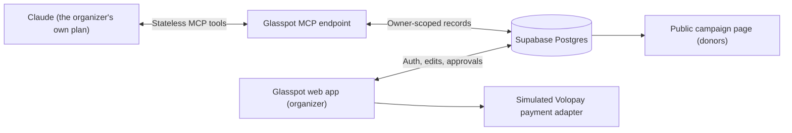

# Glasspot

**Every rupee in plain sight.**

Glasspot is a live, public, auditable ledger for community campaigns. Organizers manage needs, contributions, spends, approvals, and an exportable record; the public page shows campaign progress without exposing emails or internal notes.

## Architecture



The Volopay adapter shown above is a labelled simulation only; it does not connect to Volopay or move money.

## Data flow

1. The organizer describes a campaign request in their own Claude account.
2. Claude interprets the message and calls Glasspot's MCP tools; Glasspot itself does not interpret messages.
3. Glasspot validates the tool input, scopes access to the connector owner's campaigns, and records the requested changes in Supabase with an audit entry.
4. The organizer reviews and edits the ledger in the authenticated web app. Above-limit spends remain pending until a human decides them there.
5. Claude can call `get_campaign_status` to read fresh data, including human edits.
6. The public campaign page reads the current public ledger.

## Responsibilities and scope

**All Volopay-side capabilities and production integrations mentioned below are assumptions based on public information, not verified integrations or commitments.**

| Glasspot prototype (built) | Volopay or partner in production (assumption) | Notes |
|---|---|---|
| Messy-message interpretation is not part of Glasspot. | No Volopay role is assumed for interpretation. | The customer's own Claude handles this and calls the tools. |
| Needs, contributions, ledger, basic approvals, and audit history. | No additional Volopay capability is assumed for these Glasspot records. | A human organizer controls above-limit spend decisions. |
| A labelled simulated payment button; no issuing, vendor payment, or reimbursement is performed. | **Assumption:** Volopay or a partner could provide card issuing, vendor payments, and reimbursements in a future production system. | No real payment API is connected. |
| Per-campaign approval limit and human approval/rejection in the web app. | **Assumption:** A richer spend-policy and approval-workflow engine could be provided by Volopay or another partner. | The current limit is intentionally basic. |
| Downloadable CSV accounting export (simulated). | **Assumption:** Volopay integrations could provide production accounting connections. | No accounting system is connected. |
| KYC, compliance, foreign-donation handling, and tax rules are out of scope. | **Assumption:** Any future responsibility or support from Volopay or a partner for these areas requires separate validation. | This prototype does not provide legal, tax, or compliance functionality. |

## What is built vs. proposed

**Built in this prototype**
- Organizer sign-up/sign-in, campaign dashboard, owner-only campaign editor, and public campaign pages.
- Stateless MCP tools for campaign creation, needs, contributions, spend requests, and status read-back.
- Audit entries for organizer and MCP writes; human-only decisions for above-limit spends.
- Simulated payment action and CSV export.

**Proposed for a production system**
- OAuth-based connector authorization, configurable campaign fields, donor pledge forms, and multi-user roles.
- Notifications, templates, and verified campaign badges.
- Real payment and accounting integrations with a suitable partner, subject to security, compliance, and product validation.

## MCP tools

`campaign` accepts either a campaign slug or id where shown. Inputs are validated with Zod.

| Tool | Inputs | What it does | What it deliberately cannot do |
|---|---|---|---|
| `list_campaigns` | None | Lists the connector owner's campaigns and public URLs. | List another organizer's campaigns. |
| `create_campaign` | `title`, optional `description`, optional `approval_limit` (defaults to 10000) | Creates an owned campaign with a unique slug. | Create a campaign for another owner or set an arbitrary owner. |
| `add_needs` | `campaign`, `needs[]` (`item`, `qty_needed`, optional `unit`, `location`, `priority`) | Adds needs; skips case-insensitive duplicate item names. | Edit or delete existing needs. |
| `log_contributions` | `campaign`, `contributions[]` (`donor_name`, `type`, `amount`, optional `need_item`, `status`), optional `allow_duplicate` | Records contributions, matches needs by name, and warns about unmatched needs or recent duplicates. | Edit or delete contributions. |
| `request_spend` | `campaign`, `payee`, `amount`, optional `purpose`, optional `need_item` | Records a spend; auto-approves only at or below the campaign limit, otherwise leaves it pending for a human. | Approve or reject an above-limit spend, or move money. |
| `get_campaign_status` | `campaign` | Reads fresh needs, contributions, balance, pending spends, and the latest audit entries. | Change campaign data or make an approval decision. |

There is no MCP tool to approve, reject, edit, or delete records. Every MCP write is audited with actor `Claude`.

## No AI inside

There are no AI keys, AI SDKs, or calls to AI services in this app. The organizer's own Claude account is an external MCP client. `@modelcontextprotocol/sdk` is a protocol SDK, not an AI SDK.

The application uses only these environment variables:

```text
NEXT_PUBLIC_SUPABASE_URL=
NEXT_PUBLIC_SUPABASE_ANON_KEY=
SUPABASE_SERVICE_ROLE_KEY=
```

Keep the service-role key server-only. Never add real secret values to this README or commit `.env.local`.

## Authentication and connector trade-off

Web organizers authenticate with Supabase email/password. The MCP connector uses a unique, regenerable token in the URL rather than OAuth. This is simple to connect, but **anyone who has the URL can act as that organizer**. Keep it private; regenerating it invalidates the previous URL. OAuth is a proposed next step.

## Assumptions and limitations

- No money moves. Payments and accounting export are simulated.
- The database schema is fixed; each campaign has one owner.
- Connecting to Claude requires a plan/account that supports custom connectors.
- Serverless deployments may have cold starts.
- There is no application-level rate limiting in v1.
- Campaign records are scoped to the owner associated with the MCP token; the public page is limited to public campaign information.

## Edge cases handled

- Invalid tool inputs receive readable validation errors.
- Need names are checked case-insensitively to avoid duplicates.
- Matching contributions within the last 10 minutes are skipped with a warning by default; `allow_duplicate: true` opts in to recording them.
- Unmatched need names are recorded unlinked and reported as warnings.
- Above-limit spend requests remain pending for human approval in Glasspot.
- Unknown MCP tokens receive an unauthorized response.
- A campaign not owned by the connector token cannot be read or changed through that connector.

## Next steps

- OAuth for MCP authorization.
- Configurable fields per campaign and a donor pledge form.
- Real payments through a validated partner.
- Multi-user roles, notifications, templates, and a verified campaign badge.
- Production accounting integrations and a richer spend-policy engine.

## Run locally and connect to Claude

Prerequisites: Node.js/npm and a Supabase project.

1. Install the project dependencies:

   ```bash
   npm install
   ```

2. Create `.env.local` in the project root and fill in the three Supabase values listed above. Do not expose the service-role key to browser code.
3. In the Supabase SQL editor, run [`supabase/schema.sql`](./supabase/schema.sql).
4. Start the development server:

   ```bash
   npm run dev
   ```

5. Open [http://localhost:3000](http://localhost:3000), create an account at `/login`, and use the dashboard to create a campaign or load demo data.
6. Open `/settings` and copy the MCP URL. In Claude, open **Settings → Connectors → Add custom connector**, paste the URL, and save it.
7. In a new Claude chat, try: “Create a relief campaign called Ward 4 Flood Relief, then add these needs and donations: ...”

For a protocol check before connecting Claude, start the app and run:

```bash
npx @modelcontextprotocol/inspector --cli --transport http --server-url "http://localhost:3000/api/mcp/<your-token>" --method tools/list
```

Replace `<your-token>` with the URL token shown on your authenticated `/settings` page. Do not share that token.
